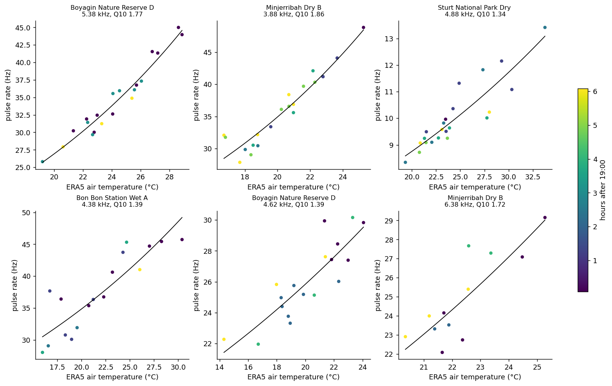
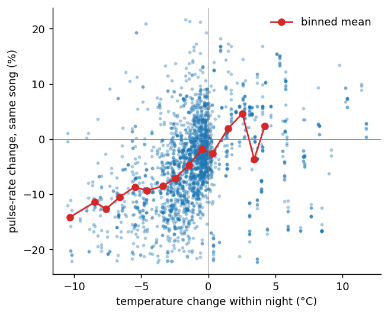
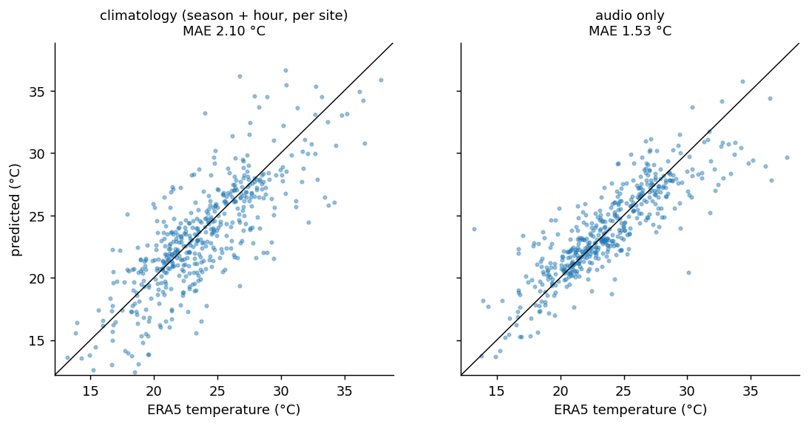

# Cricket Thermometer

**Can a microphone read the air temperature from insect song?**

Insects are ectotherms: the muscles that drive their song run faster when it is warm. For the snowy tree cricket this was written down in 1897 as Dolbear's law (count the chirps, get the temperature). This project tests whether the same holds for the whole night-time insect chorus, using a continental acoustic sensor network, and whether audio alone can serve as a thermometer.

## Data

| Source | What | Access |
|---|---|---|
| [Australian Acoustic Observatory](https://acousticobservatory.org/) (A2O) | Continuous recordings from ~360 sensors at ~90 sites across Australia, 2019 onward, 22.05 kHz, CC-BY-4.0 | Anonymous API, 40 s segments cut server side |
| ERA5 reanalysis via [Open-Meteo archive](https://open-meteo.com/en/docs/historical-weather-api) | Hourly 2 m air temperature, humidity, wind, rain at each sensor | Free API, no key |

Pilot sample: 12 sensors (one per region, spread from Tasmania at 43°S to Cape York at 12°S), 3 nights per calendar month, a 40 s clip every two hours from 19:00 to 05:00 local. 2,422 clips were analysed. Audio is never stored; only features are kept (`data/features`, 8 MB).

## Method

1. **Pulse rates per carrier band.** For each 250 Hz band from 1 to 11 kHz: amplitude envelope (STFT, 2.9 ms hop), then a Welch modulation spectrum (0.04 Hz resolution with zero padding). A pulsing insect is a sharp modulation peak in its carrier band. The fundamental is picked with a harmonic check (a peak at 1/2 or 1/3 the rate wins if it is strong enough) and refined by parabolic interpolation. A detection requires a local prominence of at least 15x over the 0.75x to 1.33x neighbourhood (a global baseline would favour slow rates, because envelope noise is roughly 1/f). Range 2 to 120 Hz.
2. **Artefact filter.** Any rate repeated to within 0.002 Hz at one site on 3 or more nights is dropped. Insects cannot do that, but machines can: Wambiana Cattle Station has a broadband 2.000 Hz tick on 10 nights, most likely an electric fence energiser. The filter removed 862 of 7,258 detections, 783 of them at Wambiana.
3. **Song units.** Within a site and band, detections are split at log-rate gaps over 0.12 (about 13%). A unit needs at least 12 detections on at least 4 nights. That gives 135 units at 9 sites. The three cool southern sites produced almost no qualifying units.
4. **Three tests:**
   - **Within night:** the same unit compared with itself across hours of one night, so species turnover and season cancel out. Time of night is controlled, since nights cool at different speeds. 95% CIs come from a bootstrap that resamples whole nights.
   - **Across season:** log(rate) on temperature, with unit and hour fixed effects.
   - **Thermometer:** each unit gets an inverse calibration (temperature on log rate) on training nights. Predictions are averaged across the units heard in a clip, with 5-fold cross-validation grouped by night. There are two baselines:
     - **Climatology:** each site's seasonal cycle (2 harmonics) plus hour of night.
     - **Presence-only:** which songs are heard, ignoring their rate. This checks whether audio just recognises summer species.

## Results

**Pulse rate rises with temperature.** 92% of song units have a positive slope. The cleanest songs follow smooth exponential curves with Q10 of 1.7 to 1.9 (rate multiplies by about 1.8 for every 10 °C). That is squarely in the range of insect muscle physiology.



**It holds within a single night, and is not an artefact of time of night.**

| Test | Slope (ln rate per °C) | 95% CI | Q10 |
|---|---|---|---|
| Within night, temperature only | 0.0117 | 0.0070 to 0.0170 | 1.12 |
| Within night, controlling for hour | 0.0087 | 0.0055 to 0.0127 | 1.09 |
| Across season, unit + hour effects | 0.0188 | 0.0154 to 0.0231 | 1.21 |
| Median single unit | 0.0239 | | 1.27 |
| Best units (r > 0.9) | 0.05 to 0.06 | | 1.7 to 1.9 |



The pooled Q10 is well below the best units. There are two likely causes, and both bias the slope toward zero:
- **ERA5 is coarse.** Its 2 m air temperature on a ~30 km grid is not the temperature of a cricket in leaf litter, and noise in the predictor attenuates a regression slope.
- **Units are sometimes mixed.** A unit can occasionally contain two species, or a misread harmonic.

**Audio beats climatology as a thermometer.** Across the 20% of clips where a calibrated song was heard:

| Predictor | MAE (°C) |
|---|---|
| Climatology (site seasonal cycle + hour) | 2.10 |
| Presence-only (which songs are singing) | 2.10 |
| **Audio pulse rate** | **1.53** |
| Climatology + audio blend | 1.43 |

46% of audio estimates fall within 1 °C of ERA5. The audio anomaly (audio minus climatology) correlates at r = 0.71 with the true anomaly, so the audio reads the actual night's weather, not just the season. Presence-only does no better than climatology, which rules out "it just recognises summer species". Site by site, audio wins clearly at the temperate and arid sites (Boyagin 0.97 vs 2.53 °C, Minjerribah 0.85 vs 1.45, Sturt 1.68 vs 2.89, Bon Bon 2.24 vs 3.55). It ties or loses at tropical sites (Orpheus Island, Staaten River), where nights vary little and climatology is already good.



## Caveats

- **Sensitivity to the unit definition.** The main definition was fixed before seeing results. Two alternatives ([sensitivity_unit_definition.csv](results/sensitivity_unit_definition.csv)):

  | Unit definition | Units | Within-night slope | Audio MAE | Climatology MAE |
  |---|---|---|---|---|
  | band (main) | 135 | 0.0087 | 1.53 | 2.10 |
  | merged across adjacent bands | 29 | 0.0099 | 1.71 | 2.32 |
  | carrier region (rate gap, then carrier gap) | 19 | 0.0089 | 2.37 | 2.25 |

  The temperature effect is robust under all three. The thermometer advantage is not: it disappears when units are defined so coarsely that species merge. Better species separation (spectral shape, a classifier) is the main thing to improve.
- **ERA5 is the reference, not ground truth.** Part of the remaining error may be real microclimate that the audio sees and ERA5 does not. A2O sites are near TERN stations with in-situ loggers, and those would settle it.
- **Coverage.** Only about 20% of night clips contain a calibrated song. Cold sites and winter nights are mostly silent, which is exactly when a thermometer is least available.
- **Small pilot.** It covers 12 sensors and 3 nights per month. The pipeline scales: `python sample_plan.py 60 4` gives about 15k clips, but the server cuts each segment in ~6 s, so allow several hours.

## Reproduce

```bash
pip install -r requirements.txt
cd src
python inventory.py          # site list + coverage  -> data/sites.csv
python sample_plan.py 12 3   # sensors, nights, clips -> data/plan.csv
python features.py 8         # download + pulse-rate features (resumable)
python temperature.py        # ERA5 per clip -> data/temperature.csv
python analyze.py            # results/ and figures/
```

## Layout

```
src/a2o.py          A2O API client (paging, retries, FLAC check)
src/inventory.py    sites with coordinates and coverage
src/sample_plan.py  sensor and night sampling
src/features.py     envelope modulation spectra and pulse-rate extraction
src/temperature.py  ERA5 via Open-Meteo
src/dataset.py      joins, detections, artefact filter
src/analyze.py      units, within-night and seasonal fits, thermometer, figures
results/            summary.json, units.csv, per-site and sensitivity tables
figures/            plots shown above
```

Audio: Australian Acoustic Observatory (CC-BY-4.0). Weather: ERA5 (Copernicus) via Open-Meteo.
